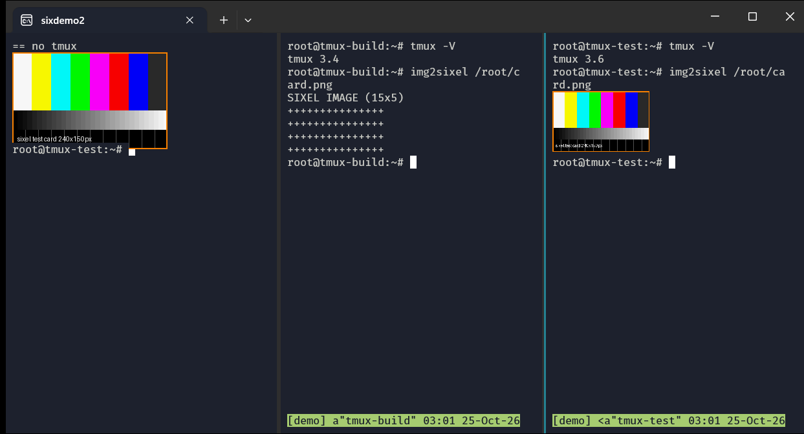

# tmux-simple-repack

A minimal backport of Ubuntu 26.04's **tmux 3.6a** to **Ubuntu 24.04 (noble)**, mainly so that
**sixel images work inside tmux under WSL + Windows Terminal**.



*Left: `img2sixel` without tmux. Middle: stock tmux 3.4 on 24.04 shows a placeholder.
Right: this backport (tmux 3.6a) draws the image, at ~62% scale (see Known limitation).*

## The problem

`img2sixel picture.jpg` works in Windows Terminal (sixel support since WT 1.22), but inside tmux 3.4
(stock noble) you only get a `SIXEL IMAGE (WxH)` placeholder made of `+` signs.

Root cause: under WSL, the pty reports a window size of `cols x rows` with **0x0 pixels**
(`TIOCGWINSZ` → `ws_xpixel = ws_ypixel = 0`). ConPTY has no API to pass pixel sizes
([microsoft/terminal#8581](https://github.com/microsoft/terminal/issues/8581), open since 2020).
tmux 3.4 sees zeros and falls back to `SIXEL IMAGE (WxH)` text.

tmux 3.6 asks the terminal itself (`CSI 14 t` / `CSI 18 t`) when the ioctl returns zeros
([tmux#4099](https://github.com/tmux/tmux/issues/4099)), and Windows Terminal answers those
correctly. The tmux config is irrelevant; it is purely a version issue.

## Install

Grab the `.deb` from [Releases](../../releases) (or build it, see below), then:

```bash
tmux kill-server          # REQUIRED: a 3.4 server and a 3.6 client are incompatible (client may hang)
sudo apt install ./tmux_3.6a-*~24.04.*_amd64.deb
```

Escape hatch, if you need to reach an old server that is still running:
`/proc/$(pgrep "tmux: server")/exe attach`.

Rollback: `sudo apt install tmux=3.4-1ubuntu0.2` (or whatever `apt policy tmux` lists).

The version suffix `~24.04.N` sorts **below** the 26.04 package, so a later release upgrade
replaces it cleanly.

### Config notes for 3.6

- `terminal-features ... :sixel` is no longer needed: tmux 3.6 detects sixel from the DA1 reply.
- Options removed back in tmux 2.9 (`status-utf8`, `*-fg`, `*-bg`, `*-attr`) still produce errors;
  replace them with `*-style`.

## What the backport changes

Only two things on top of the Ubuntu `resolute` source package (all Ubuntu patches, including the
sixel CVE fix, are kept):

1. `Build-Depends: libncurses-dev (>> 6.5)` → `libncurses-dev` (noble has 6.4; the constraint only
   exists for Debian's 6.5 symbol transition).
2. Force `-ljemalloc` with `--no-as-needed`. On noble, `--as-needed` + LTO silently drops jemalloc
   and the binary falls back to glibc malloc; the official package links jemalloc.

## Build

Requires LXD. Everything happens in throwaway containers; nothing is installed on the host.

```bash
./build.sh            # → out/*.deb, *.dsc, *.debian.tar.xz, build logs
./test.sh             # installs out/*.deb over stock tmux in a clean 24.04 container and checks sixel
```

Knobs: `TARGET=24.04`, `SRC_SERIES=resolute`, `REV=1`, `KEEP=1` (keep the container),
`DEBFULLNAME`/`DEBEMAIL` (changelog maintainer, defaults to your git identity).
When Ubuntu publishes a new tmux in resolute (e.g. a security fix), just rerun `./build.sh`.

## Testing without a GUI

`test/fakewt.py` pretends to be Windows Terminal: it runs a tmux client in a pty with 0x0 pixels,
answers `CSI 14t/16t/18t` and DA1 the way WT does, sends `img2sixel` into the pane and checks whether
a sixel `ESC P … q` or the `SIXEL IMAGE` placeholder reached the "terminal". The test suite includes
control cases: the bug has to reproduce on stock 3.4 for the run to pass.

For testing in a real Windows Terminal from WSL, see [README.WSL-TMUX.md](README.WSL-TMUX.md).

## Known limitation (upstream, also in 3.8)

The queried cell size (e.g. 10x20 px) is applied to the client only; windows and pane ptys keep the
default 16x32. As a result, images inside tmux are drawn at **~62%** of their size (10/16). Resizing
does not help. Verified with tmux 3.6a and upstream 3.8.
